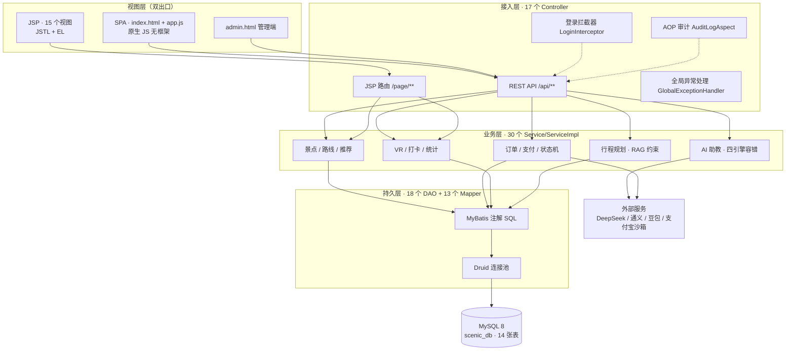
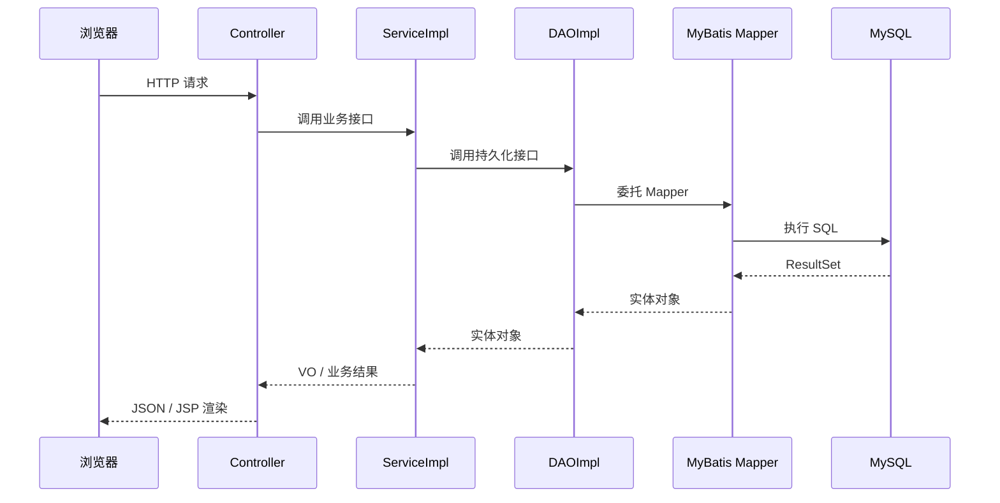
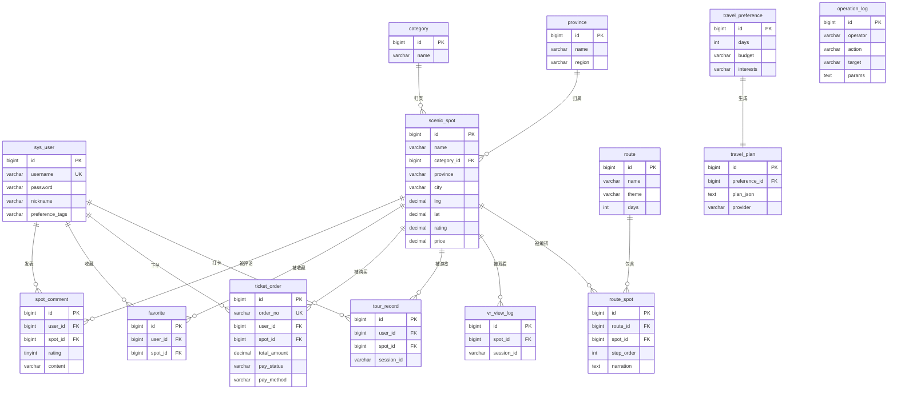

# 云游中国 · SSM 旅游导览平台

> 基于 **Spring 7 + Spring MVC + MyBatis + MySQL 8** 的全国景点导览系统，覆盖 31 个省份 231 条真实景点数据。
> 在传统 SSM 五层架构上，落地了 AI 多引擎容错、VR 环景舱、智能行程规划、支付宝沙箱支付、AOP 审计等工程化能力。


---

## 一、项目概览

| 指标 | 数值 |
| --- | --- |
| Java 类 / 代码量 | **115 个 / 7,128 行** |
| 数据库表 | **14 张**（7 个业务域） |
| 景点数据 | **231 条**真实景点，覆盖 31 省，全部带经纬度 |
| 路线 / 评论 | 16 条主题路线 / 335 条评论 |
| 视图层 | **SPA（原生 JS）+ 15 个 JSP 视图** 双出口并存 |
| 后端接口 | 17 个 Controller，REST API + JSP 路由双通道 |

---

## 二、技术栈

| 层次 | 技术选型 |
| --- | --- |
| 容器 / 运行 | Tomcat 11（Jakarta EE 10）、JDK 17 |
| 核心框架 | Spring 7.0.9（IoC / MVC / AOP / 事务） |
| 持久层 | MyBatis 3.5.19 + Druid 连接池 + MySQL 8 |
| 视图层 | JSP + JSTL + EL（传统 SSM 演示） / 原生 JS SPA（前后端分离） |
| 前端 | HTML5 / CSS3 / 原生 JS（零框架依赖）、Leaflet 1.9.4 地图 |
| AI 能力 | DeepSeek → 通义千问 → 豆包（OpenAI 兼容协议）+ 本地规则兜底 |
| 支付 | 支付宝沙箱 SDK 4.40.909（RSA2 签名 / 主动查询对账） |
| 架构模式 | Controller → Service(接口) → ServiceImpl → DAO(接口) → DAOImpl → Mapper 五层 |

---

## 三、系统架构



### 五层调用链



---

## 四、数据库设计（14 张表 · 7 个业务域）



| 业务域 | 表 |
| --- | --- |
| 景点域 | `scenic_spot`、`category`、`province` |
| 用户域 | `sys_user`、`spot_comment`、`favorite` |
| 订单域 | `ticket_order` |
| 路线域 | `route`、`route_spot` |
| 打卡域 | `tour_record`、`vr_view_log` |
| 规划域 | `travel_preference`、`travel_plan` |
| 审计域 | `operation_log` |

> 建表脚本全部使用 `CREATE TABLE IF NOT EXISTS`，应用启动时幂等执行；仅在空库时灌入种子数据，做到「一次启动即可运行」。

---

## 五、核心亮点

### 1. AI 四引擎故障转移
`DeepSeek → 通义千问 → 豆包 → 本地规则库` 依次降级，任一环节超时或报错自动切换，保证 AI 对话永不中断。不同模型分别设置 8s / 10s / 15s 的失败阈值，避免误杀正常请求。

### 2. RAG 约束式生成
AI 讲解词与游记生成前，先从 MySQL 读取景点真实数据（名称、省份、评分、特色）拼装进 Prompt，约束模型不得编造不存在的信息；失败时回退到基于景点 ID 确定性轮换的本地文案模板。

### 3. 订单状态机 + 幂等
`PENDING → PAID → CANCELED` 三态流转，全部在 `@Transactional` 内完成；支付回调与主动查询接口做幂等校验，重复通知不会重复扣减。

### 4. 三通道支付
支持沙箱模拟支付、支付宝沙箱跳转、主动查询对账三种方式。沙箱支付完成后通过 `alipay.trade.query` 主动确认状态，规避本地无公网 HTTPS 无法接收异步通知的限制。

### 5. VR 双模式环景舱
5 个精选景点使用 6 面立方体贴图实现真 360° 球面全景（Pannellum 方案），其余景点回退到 CSS 3D 圆柱投影，无全景数据时不降级、不白屏。

### 6. AOP 零侵入审计
`@Aspect` 切面拦截管理端写操作，自动记录操作人、动作、目标、参数摘要与时间，Controller 代码零改动。

### 7. SPA + JSP 双视图
同一套 Service 层同时支撑 REST + 原生 JS 的单页应用，以及 15 个 JSTL/EL 渲染的传统 JSP 页面，验证分层解耦。

### 8. 全国地图与 31 省导览
Leaflet + 高德瓦片，231 个真实坐标打点；省份维度聚合页按七大地理分区展示。

---

## 六、快速开始

### 环境要求

| 组件 | 版本 |
| --- | --- |
| JDK | 17+ |
| Maven | 3.8+ |
| MySQL | 8.0 |
| Tomcat | 11（Jakarta EE 10） |

### 1. 初始化数据库

```sql
CREATE DATABASE IF NOT EXISTS scenic_db DEFAULT CHARSET utf8mb4;
CREATE USER IF NOT EXISTS 'scenic'@'localhost' IDENTIFIED BY 'scenic123';
GRANT ALL PRIVILEGES ON scenic_db.* TO 'scenic'@'localhost';
FLUSH PRIVILEGES;
```

建表与种子数据由应用启动时自动执行 `schema.sql` + `data.sql`，无需手工导入。

### 2. 配置密钥

```bash
# AI 三引擎 Key
cp src/main/resources/ai.properties.example src/main/resources/ai.properties

# 支付宝沙箱（可选，不配置则仅沙箱模拟支付可用）
cp src/main/resources/alipay.properties.example src/main/resources/alipay.properties
```

编辑两个文件填入自己的 API Key 与沙箱应用信息。**这两个文件已被 `.gitignore` 排除，不会入库。**

### 3. 构建与部署

```bash
mvn clean package
```

IDEA 中配置 Tomcat 11，Deployment 选择 `untitled8:war exploded`，Application context 设为 `/`，启动后访问：

| 入口 | 地址 |
| --- | --- |
| SPA 首页 | http://localhost:8080/ |
| JSP 首页 | http://localhost:8080/page/home |
| 管理端 | http://localhost:8080/admin.html （admin / admin123） |

---

## 七、目录结构

```
untitled8/
├── pom.xml
├── src/main/java/cn/edu/qut/
│   ├── config/          配置装配（数据源 / MyBatis / 事务 / 启动自举）
│   ├── controller/      17 个控制器（REST + JSP 双出口）
│   ├── service/         30 个业务接口与实现
│   ├── dao/             18 个 DAO 接口与实现
│   ├── mapper/          13 个 MyBatis Mapper
│   ├── entity/          13 个实体
│   ├── vo/ dto/         视图对象与请求对象
│   ├── pay/             支付宝 / 微信支付封装
│   ├── aop/             审计切面
│   └── support/         登录拦截 / 全局异常 / LLM 客户端
├── src/main/resources/
│   ├── schema.sql       14 张表幂等建表
│   ├── data.sql         231 条景点种子数据
│   └── *.properties.example  配置模板
└── src/main/webapp/
    ├── index.html       SPA 入口
    ├── admin.html       管理端
    ├── static/          CSS / JS / 全景图 / Leaflet
    └── WEB-INF/views/   15 个 JSP 视图
```

---

## 八、主要接口

| 模块 | 接口 | 说明 |
| --- | --- | --- |
| 认证 | `POST /api/auth/login` · `/register` · `/logout` · `GET /me` | Session 会话 |
| 景点 | `GET /api/spots` · `/{id}` · `/map` · `/ranking` | 分页 / 详情 / 地图 / 排行 |
| 推荐 | `GET /api/recommend` | 基于偏好标签加权 |
| AI | `POST /api/ai/chat` · `/journal` · `/explain` | 四引擎容错 |
| 规划 | `POST /api/planner` | RAG 约束行程生成 |
| 订单 | `POST /api/orders` · `/cancel` · `GET /my` | 状态机 |
| 支付 | `POST /api/alipay/pay` · `GET /return` · `/query` | 沙箱 |
| VR | `POST /api/vr/view` · `GET /api/pano/{id}` | 打卡 / 全景素材 |
| 管理 | `POST /api/admin/login` · `GET /api/admin/logs` | 审计日志 |

---

## 九、说明

- 项目为 Java Web 课程设计作品，景点数据取自公开资料，图片使用稳定占位图源。
- 支付为**支付宝沙箱环境**，不涉及真实资金。
- AI Key 与支付私钥均已从仓库移除，仅保留 `.example` 模板。
